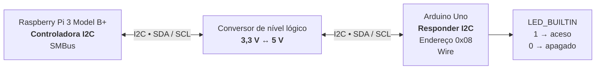
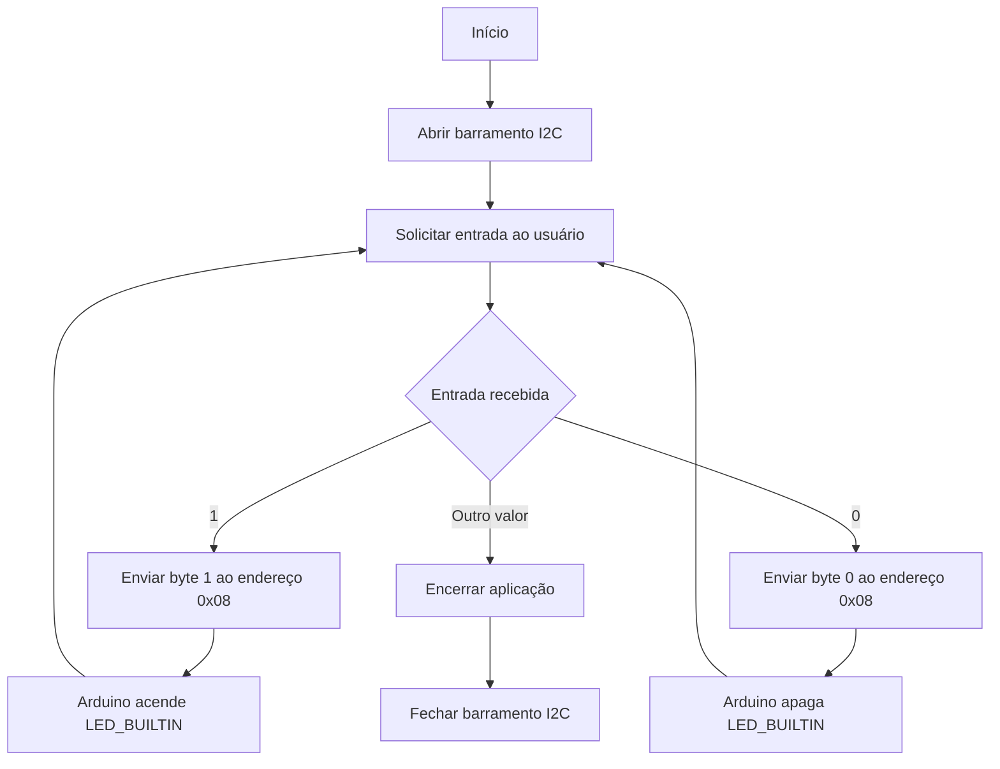
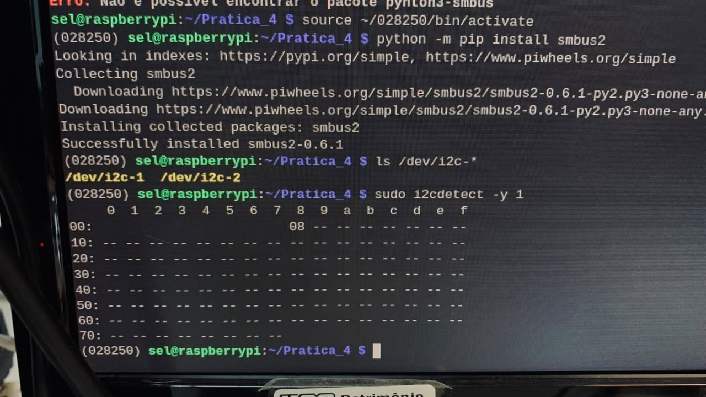
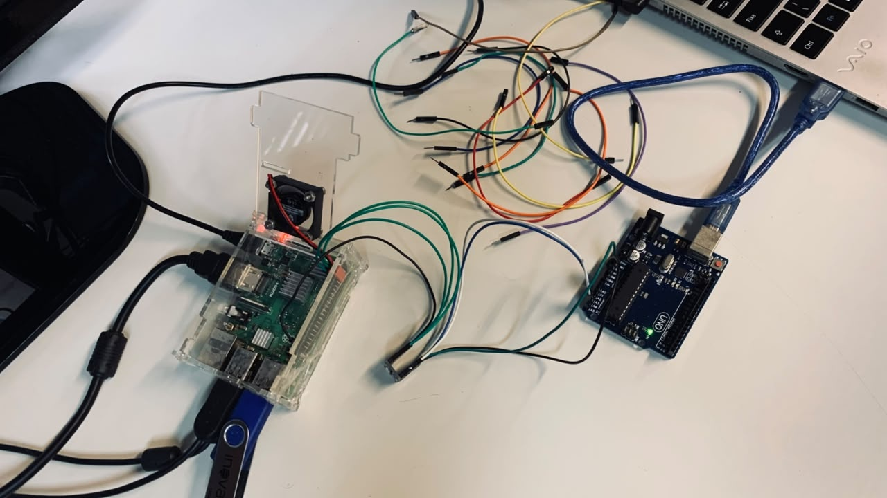
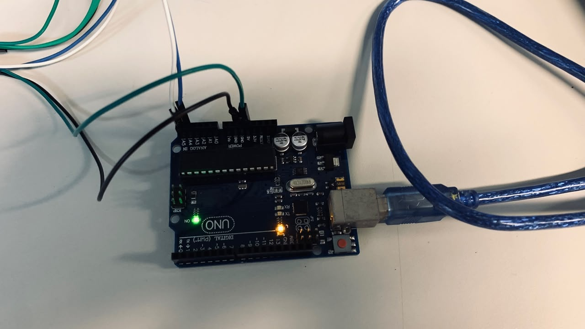

# Prática 4 — Checkpoint 1

**Disciplina:** SEL0337 — Projetos em Sistemas Embarcados  
**Tema:** Comunicação I2C entre Raspberry Pi e Arduino Uno

| Integrante | NUSP |
|---|---:|
| João Vitor Miranda Sousa | 14802702 |
| Fernando Shoji Ogusuku | 15636682 |
| Eduardo Yumoto Carvalheira | 15636150 |

## Resumo

Este checkpoint implementa e valida uma comunicação I2C entre uma Raspberry Pi 3 Model B+ e um Arduino Uno. A Raspberry Pi atua como dispositivo controlador e envia comandos pelo barramento I2C, enquanto o Arduino atua como dispositivo responder no endereço `0x08`. Os comandos `1` e `0` são utilizados para, respectivamente, acender e apagar o `LED_BUILTIN` do Arduino. A montagem utiliza um conversor de nível lógico bidirecional para compatibilizar os níveis de 3,3 V da Raspberry Pi e 5 V do Arduino.

## 1. Objetivo

O objetivo do Checkpoint 1 é estabelecer e validar a comunicação I2C entre a Raspberry Pi e o Arduino Uno.

A aplicação permite:

- digitar `1` no terminal da Raspberry Pi para acender o `LED_BUILTIN`;
- digitar `0` para apagar o `LED_BUILTIN`;
- inserir qualquer outro valor para encerrar a aplicação;
- verificar no monitor serial do Arduino o comando recebido;
- confirmar a presença do Arduino no barramento por meio de `i2cdetect`.

Os códigos desenvolvidos estão disponíveis em:

- [`cp1_raspberry_i2c_led.py`](cp1_raspberry_i2c_led.py)
- [`cp1_arduino_i2c_led.ino`](cp1_arduino_i2c_led.ino)

## 2. Arquitetura do sistema

A Raspberry Pi foi configurada como **controladora I2C**, enquanto o Arduino Uno atua como **dispositivo responder**, utilizando o endereço `0x08`. Como as plataformas operam em níveis lógicos distintos, a comunicação é realizada por meio de um conversor de nível lógico bidirecional.



A Raspberry Pi utiliza a biblioteca `SMBus` para acessar o barramento I2C, enquanto o Arduino utiliza a biblioteca `Wire`. A comunicação ocorre pelas linhas **SDA** e **SCL**, com conversão bidirecional dos níveis lógicos entre 3,3 V e 5 V.

## 3. Interface elétrica

Raspberry Pi e Arduino Uno operam com níveis lógicos distintos. A GPIO da Raspberry Pi utiliza 3,3 V, enquanto o Arduino Uno opera em 5 V. Por esse motivo, foi utilizado um **conversor de nível lógico bidirecional** entre as duas plataformas.

| Sinal | Raspberry Pi | Lado LV | Lado HV | Arduino Uno |
|---|---|---|---|---|
| SDA | GPIO 2 | LVx | HVx | A4 |
| SCL | GPIO 3 | LVx | HVx | A5 |
| Alimentação | 3,3 V | LV | HV | 5 V |
| Referência | GND | GND | GND | GND |

O uso do level shifter evita a aplicação direta de sinais de 5 V aos pinos de 3,3 V da Raspberry Pi.

## 4. Implementação

### 4.1 Raspberry Pi

O script Python abre o barramento I2C 1 e estabelece comunicação com o Arduino Uno no endereço `0x08`.

O fluxo principal da aplicação é apresentado a seguir:



A aplicação também trata falhas de comunicação I2C e garante o fechamento do barramento ao término da execução.

A execução do script na Raspberry Pi é realizada por meio de:

```bash
python3 cp1_raspberry_i2c_led.py
```


### 4.2 Arduino Uno

O Arduino é inicializado como responder I2C:

```cpp
Wire.begin(I2C_ADDRESS);
Wire.onReceive(onI2CReceive);
Wire.onRequest(onI2CRequest);
```

O callback de recepção armazena o comando recebido e o processamento é realizado no `loop()`. Essa organização mantém o callback I2C curto e evita processamento desnecessário durante o atendimento ao barramento.

O comportamento implementado é:

```text
1 -> LED_BUILTIN = HIGH
0 -> LED_BUILTIN = LOW
```

O monitor serial também apresenta o comando processado.

## 5. Validação experimental

### 5.1 Detecção do Arduino no barramento

A comunicação foi inicialmente verificada com:

```bash
sudo i2cdetect -y 1
```

<p align="center">
  
</p>

<p align="center"><em>Figura 1 — Arduino identificado no endereço I2C 0x08.</em></p>

A identificação do endereço `08` confirma que o Arduino estava acessível no barramento utilizado pela Raspberry Pi.

### 5.2 Montagem prática

<p align="center">
  
</p>

<p align="center"><em>Figura 2 — Montagem prática da comunicação I2C utilizando conversor de nível lógico.</em></p>

### 5.3 Acionamento do LED

<p align="center">
  
</p>

<p align="center"><em>Figura 3 — Arduino Uno durante a validação experimental do LED_BUILTIN.</em></p>

Durante os ensaios, os comandos enviados pela Raspberry Pi foram recebidos pelo Arduino e produziram a alteração esperada do estado do LED.

## 6. Resultados

O Checkpoint 1 foi validado experimentalmente com os seguintes resultados:

- Arduino identificado no endereço `0x08` pelo comando `i2cdetect`;
- envio de comandos da Raspberry Pi pelo barramento I2C;
- recepção dos bytes pelo Arduino Uno;
- comando `1` acionando o `LED_BUILTIN`;
- comando `0` desligando o `LED_BUILTIN`;
- mensagens de funcionamento apresentadas no monitor serial;
- comunicação realizada com interface elétrica adequada entre 3,3 V e 5 V.

### Requisitos do checkpoint

| Requisito | Evidência |
|---|---|
| Arduino detectado no barramento I2C | `i2cdetect` identificando `0x08` |
| Raspberry Pi envia comandos via I2C | Script `cp1_raspberry_i2c_led.py` |
| Arduino recebe e interpreta os comandos | Script `cp1_arduino_i2c_led.ino` e monitor serial |
| Comando `1` acende o `LED_BUILTIN` | Validado experimentalmente |
| Comando `0` apaga o `LED_BUILTIN` | Validado experimentalmente |
| Uso de `SMBus` na Raspberry Pi | Implementado no script Python |
| Uso de `Wire` no Arduino | Implementado no sketch Arduino |


## 7. Estrutura dos arquivos

```text
checkpoint_1/
├── README.md
├── cp1_arduino_i2c_led.ino
├── cp1_raspberry_i2c_led.py
├── entrega_checkpoint_1.txt
└── imagens/
    ├── cp1_arduino_led.jpeg
    ├── cp1_i2cdetect_endereco_08.jpeg
    └── cp1_montagem_i2c.jpeg
```

## 8. Conclusão

O Checkpoint 1 permitiu estabelecer com sucesso uma comunicação serial síncrona I2C entre uma plataforma Linux embarcada e um microcontrolador. A Raspberry Pi desempenhou a função de controladora do barramento e o Arduino Uno atuou como responder, recebendo comandos para controlar o LED integrado.

A utilização de um conversor de nível lógico bidirecional garantiu a compatibilidade elétrica entre as duas plataformas. A detecção do endereço `0x08`, o envio e a recepção dos comandos e a resposta correta do `LED_BUILTIN` confirmaram o funcionamento físico e lógico da comunicação.
