# Prática 4 — Checkpoint 2

**Disciplina:** SEL0337 — Projetos em Sistemas Embarcados

**Tema:** Aquisição analógica no Arduino e transmissão I²C para Raspberry Pi

| Integrante | NUSP |
|:--|--:|
| João Vitor Miranda Sousa | 14802702 |
| Fernando Shoji Ogusuku | 15636682 |
| Eduardo Yumoto Carvalheira | 15636150 |

## Resumo

Este checkpoint amplia a comunicação I²C estabelecida no Checkpoint 1 por meio da aquisição de um sinal analógico no Arduino Uno e da transmissão do resultado à Raspberry Pi 3 Model B+. Um potenciômetro conectado à entrada `A0` fornece a tensão de entrada ao conversor analógico-digital (ADC) de 10 bits do ATmega328P. O resultado, compreendido entre **0 e 1023**, é disponibilizado em dois bytes ao controlador I²C, que recupera o valor original em Python. Os ensaios em bancada confirmaram leituras nos extremos da faixa e na região central, com correspondência entre os valores enviados e recebidos.

## 1. Objetivo

Demonstrar a aquisição, transmissão e reconstrução de dados analógicos entre duas plataformas embarcadas, preservando a resolução do ADC e empregando as bibliotecas `Wire` (Arduino) e `SMBus` (Raspberry Pi).

Os códigos-fonte da aplicação são:

- [`cp2_arduino_i2c_pot.ino`](cp2_arduino_i2c_pot.ino) — aquisição ADC e resposta às requisições I²C;
- [`cp2_raspberry_i2c_pot.py`](cp2_raspberry_i2c_pot.py) — leitura I²C e reconstrução dos dados.

## 2. Arquitetura do sistema

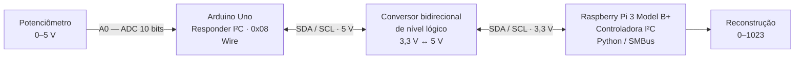

A Raspberry Pi inicia cada transação I²C no barramento 1, solicitando dois bytes ao Arduino, que atua como dispositivo responder no endereço `0x08`. O conversor de nível lógico bidirecional compatibiliza a interface de 3,3 V da Raspberry com a de 5 V do Arduino.

### 2.1 Interface elétrica

| Sinal | Raspberry Pi | Conversor de nível | Arduino Uno |
|:--|:--|:--|:--|
| SDA | GPIO 2 (pino 3) | canais LVx ↔ HVx | A4 / SDA |
| SCL | GPIO 3 (pino 5) | canais LVy ↔ HVy | A5 / SCL |
| Alimentação lógica | 3,3 V | LV / HV | 5 V |
| Referência elétrica | GND | GND comum | GND |
| Entrada analógica | — | — | A0 (cursor do potenciômetro) |

Os dois terminais externos do potenciômetro são conectados a **5 V** e **GND** do Arduino; seu terminal central (cursor) é conectado à entrada **A0**. A interconexão I²C é realizada exclusivamente através do conversor bidirecional, evitando aplicar sinais de 5 V diretamente às GPIOs da Raspberry Pi.

## 3. Protocolo de comunicação e implementação

O conversor analógico-digital (ADC) do Arduino Uno possui resolução de **10 bits**, fornecendo valores inteiros de **0 a 1023** para a tensão aplicada à entrada `A0`. Como cada unidade de dados transmitida pelo I²C contém 8 bits, a amostra é organizada em dois bytes, sem perda dos bits mais significativos.

### 3.1 Organização dos dados

O protocolo adota a ordem **byte mais significativo primeiro** (*MSB first*):

| Campo | Valor ou representação | Finalidade |
|:--|:--|:--|
| Endereço I²C do Arduino | `0x08` | Identificar o dispositivo responder |
| Primeiro byte | `highByte(valor)` | Transportar os bits mais significativos |
| Segundo byte | `lowByte(valor)` | Transportar os oito bits menos significativos |
| Resposta por requisição | 2 bytes | Preservar a leitura completa de 10 bits |

Na Raspberry Pi, a recomposição da amostra é realizada por deslocamento de bits e operação lógica OR:

$$
\boxed{N_{\mathrm{ADC}}=(b_{\mathrm{alto}}\ll 8)\;|\;b_{\mathrm{baixo}}}
$$

Para o valor máximo do conversor, o procedimento é:

| Etapa | Representação |
|:--|:--|
| Leitura original | `1023` (`0x03FF`) |
| Byte alto | `0x03` |
| Byte baixo | `0xFF` |
| Reconstrução | `(3 << 8) \| 255 = 1023` |

A leitura `1023` ultrapassa o máximo representável por um byte (`255`), demonstrando por que os dois bytes são necessários.

### 3.2 Implementação no Arduino Uno

O Arduino é configurado como dispositivo **responder I²C** por meio de `Wire.begin(0x08)`. A aquisição analógica é realizada periodicamente por `analogRead(A0)`, com intervalo programado de aproximadamente 20 ms, e o valor mais recente é armazenado em uma variável de 16 bits.

Quando a Raspberry solicita uma leitura, o callback registrado com `Wire.onRequest()` envia os dois bytes da mesma amostra. O valor enviado é apresentado no **Serial Monitor**, em 9600 baud, pelo `loop()` principal, mantendo o callback curto e sem operações seriais de impressão.

### 3.3 Implementação na Raspberry Pi

O script Python utiliza `SMBus(1)` para acessar o barramento I²C e `read_i2c_block_data(0x08, 0x00, 2)` para solicitar a resposta de dois bytes. Essa operação também transmite um byte de comando (`0x00`), que é recebido e descartado pelo Arduino, pois o protocolo implementado não utiliza registradores de comando.

Após a recepção, a aplicação recompõe a amostra, verifica se o resultado pertence ao intervalo de 0 a 1023 e exibe o valor digital e uma tensão estimada:

$$
V_{\mathrm{estimada}}=\frac{N_{\mathrm{ADC}}}{1023}\cdot 5{,}0\,\mathrm{V}
$$

A estimativa considera uma tensão de referência **nominal** de 5,0 V; não representa medição independente com instrumento. As requisições são realizadas aproximadamente a cada 0,5 s.

## 4. Validação experimental

### 4.1 Detecção no barramento

O comando abaixo identificou o dispositivo no endereço `0x08`:

```bash
sudo i2cdetect -y 1
```

<p align="center">
  <a href="imagens/cp2_i2cdetect_08.jpeg">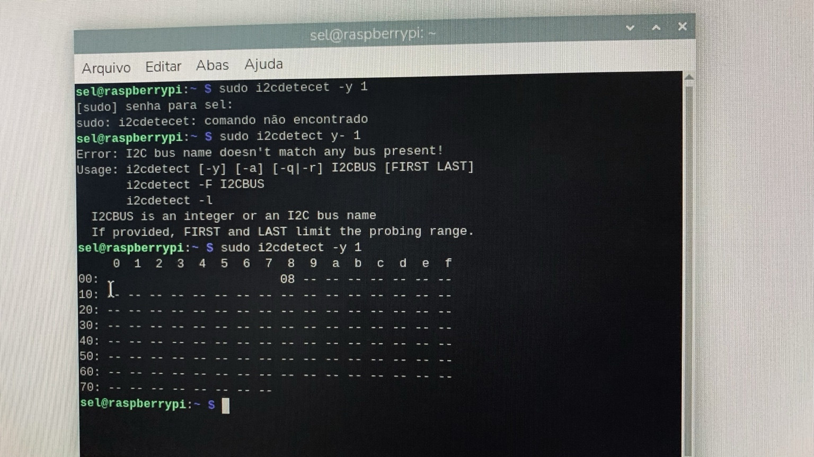</a>
</p>
<p align="center"><em>Figura 1 — Detecção do Arduino no barramento I²C da Raspberry Pi.</em></p>

### 4.2 Leituras do potenciômetro

Os ensaios foram realizados em três posições do potenciômetro, verificando a aquisição analógica, a comunicação I²C e a reconstrução do valor na Raspberry Pi. As leituras dos dois terminais foram compatíveis nas três posições. Na região intermediária, houve pequenas oscilações entre amostras sucessivas, como esperado para uma entrada analógica.

| Condição de ensaio | Arduino — enviado | Raspberry Pi — recebido | Tensão calculada¹ |
|:--|--:|--:|--:|
| Mínimo | **0** | **0** | 0,000 V |
| Região intermediária | **524–525** | **524–526** | 2,561–2,571 V |
| Máximo | **1023** | **1023** | 5,000 V |

<sub>¹ Estimativa calculada pelo programa com referência nominal de 5 V, não uma medição externa de tensão.</sub>

#### Ensaio A — posição mínima

O potenciômetro foi posicionado no extremo inferior de seu curso. Tanto o Arduino quanto a Raspberry Pi registraram o valor digital **0**.

<p align="center">
  <a href="imagens/cp2_arduino_minimo.png">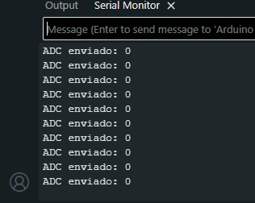</a>
</p>
<p align="center"><em>Figura 2 — Arduino Uno: valor transmitido no extremo inferior, ADC = 0.</em></p>

<p align="center">
  <a href="imagens/cp2_raspberry_minimo.jpeg">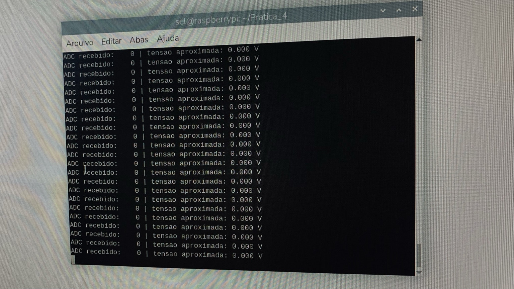</a>
</p>
<p align="center"><em>Figura 3 — Raspberry Pi: leitura recuperada no extremo inferior, ADC = 0.</em></p>

#### Ensaio B — região intermediária

Na região intermediária, o Arduino registrou valores entre **524 e 525**, enquanto a Raspberry Pi registrou valores entre **524 e 526**. Essa pequena oscilação é compatível com variações entre amostras sucessivas e não caracteriza, por si só, divergência na reconstrução.

<p align="center">
  <a href="imagens/cp2_arduino_central.png">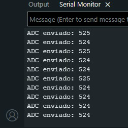</a>
</p>
<p align="center"><em>Figura 4 — Arduino Uno: leituras transmitidas na região intermediária.</em></p>

<p align="center">
  <a href="imagens/cp2_raspberry_central.jpeg">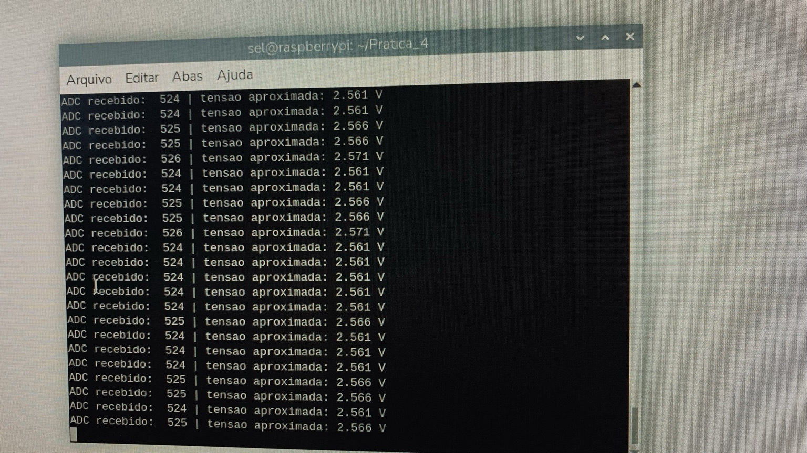</a>
</p>
<p align="center"><em>Figura 5 — Raspberry Pi: leituras recuperadas na região intermediária.</em></p>

#### Ensaio C — posição máxima

No extremo superior do potenciômetro, ambas as plataformas registraram **1023**, correspondente ao valor máximo representável pelo ADC de 10 bits.

<p align="center">
  <a href="imagens/cp2_arduino_maximo.png">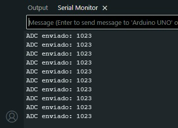</a>
</p>
<p align="center"><em>Figura 6 — Arduino Uno: valor transmitido no extremo superior, ADC = 1023.</em></p>

<p align="center">
  <a href="imagens/cp2_raspberry_maximo.jpeg">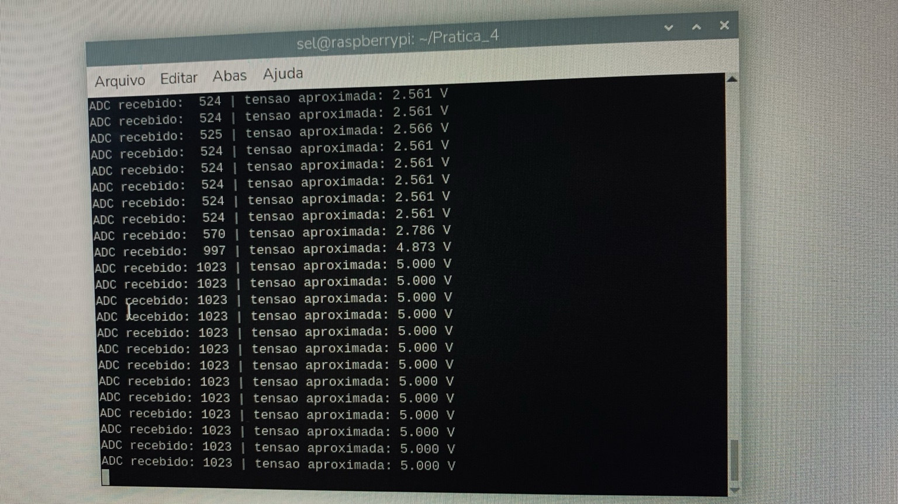</a>
</p>
<p align="center"><em>Figura 7 — Raspberry Pi: valor reconstruído no extremo superior, ADC = 1023.</em></p>

A recuperação de **1023**, valor superior a **255** (limite de um único byte), comprova nos ensaios a preservação da informação de 10 bits. As capturas dos dois terminais documentam os três pontos de operação; os registros não representam uma comparação sincronizada de cada amostra individual.

### 4.3 Montagem física

<p align="center">
  <a href="imagens/cp2_montagem_geral.jpeg">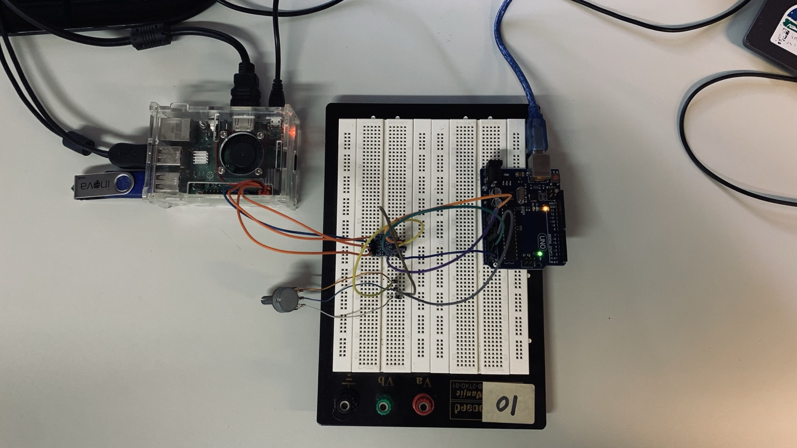</a>
</p>
<p align="center"><em>Figura 8 — Montagem experimental com Raspberry Pi, Arduino Uno, protoboard, conversor de nível lógico e potenciômetro.</em></p>

<p align="center">
  <a href="imagens/cp2_arduino_montagem.jpeg">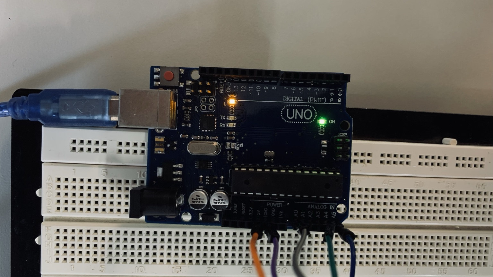</a>
  <a href="imagens/cp2_potenciometro_level_shifter.jpeg">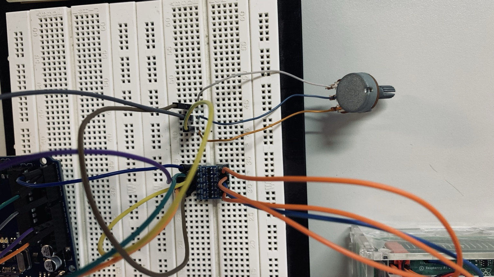</a>
</p>
<p align="center"><em>Figura 9 — Detalhes da placa Arduino Uno, do potenciômetro e do conversor de nível lógico.</em></p>

## 5. Verificação dos requisitos

| Requisito do Checkpoint 2 | Evidência |
|:--|:--|
| Leitura analógica do potenciômetro | Valores variáveis na faixa de 0 a 1023 |
| Comunicação Arduino ↔ Raspberry por I²C | Detecção do endereço `0x08` e requisições periódicas |
| Transmissão do valor de 10 bits sem truncamento | Divisão em dois bytes e reconstrução por deslocamento de bits |
| Comparação dos valores nos terminais | Valores correspondentes nos ensaios de mínimo, região central e máximo |
| Validação física | Fotografias da montagem e dos componentes interligados |


### 5.1 Validação automatizada do protocolo

Além dos ensaios realizados em bancada, a lógica de reconstrução dos dados foi submetida a testes automatizados utilizando o módulo `unittest` da biblioteca padrão do Python.

Os testes foram projetados para execução independente do hardware, empregando um barramento I²C simulado para verificar o comportamento das funções de leitura e decodificação.

| Teste | Verificação | Resultado |
|:--|:--|:--:|
| Reconstrução integral | Todos os 1.024 valores possíveis do ADC de 10 bits | Aprovado |
| Validação de entradas | Rejeição de bytes inválidos e valores superiores a 1023 | Aprovado |
| Simulação I²C | Endereço, byte de comando, comprimento e reconstrução da leitura | Aprovado |
| Integridade da resposta | Rejeição de respostas com comprimento incorreto | Aprovado |
| Limite do conversor | Rejeição de valores reconstruídos fora da faixa de 10 bits | Aprovado |

A suíte de testes está disponível em [`testes/test_cp2_adc.py`](testes/test_cp2_adc.py).

Para reproduzir a validação a partir do diretório `checkpoint_2`, execute:

```bash
python3 -m unittest discover -s testes -p "test_*.py" -v
```

**Resultado:** cinco testes aprovados, incluindo a verificação exaustiva dos 1.024 códigos possíveis do ADC.

Essa validação verifica a lógica do software e a interpretação de respostas simuladas, complementando os ensaios físicos de comunicação I²C realizados no laboratório.


## 6. Execução

No Arduino IDE, selecionar **Arduino Uno**, gravar `cp2_arduino_i2c_pot.ino` na placa e abrir o Serial Monitor em **9600 baud**. Na Raspberry Pi, com I²C habilitado e o endereço `0x08` detectado, executar:

```bash
python3 cp2_raspberry_i2c_pot.py
```

A aplicação solicita amostras aproximadamente a cada 0,5 s e apresenta o código ADC recebido e a tensão calculada. A execução é encerrada com `Ctrl+C`.

## 7. Conclusão

O Checkpoint 2 demonstrou a integração entre aquisição analógica de baixo nível e processamento de alto nível por meio de comunicação I²C. O Arduino Uno realizou a conversão A/D de 10 bits e disponibilizou os resultados em dois bytes; a Raspberry Pi recuperou os valores sem redução da resolução. Os registros experimentais contemplaram os extremos **0** e **1023** e leituras intermediárias próximas de **524–526**, confirmando o comportamento esperado da aplicação e o atendimento ao objetivo do roteiro.
