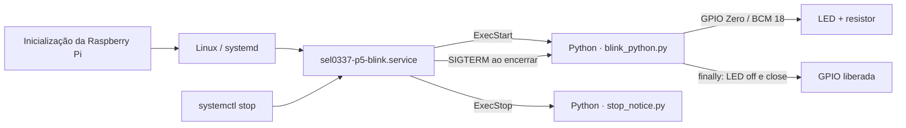
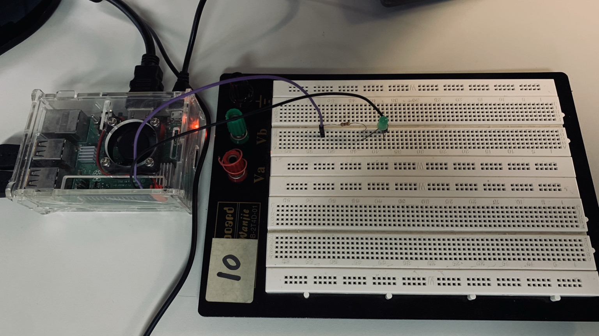
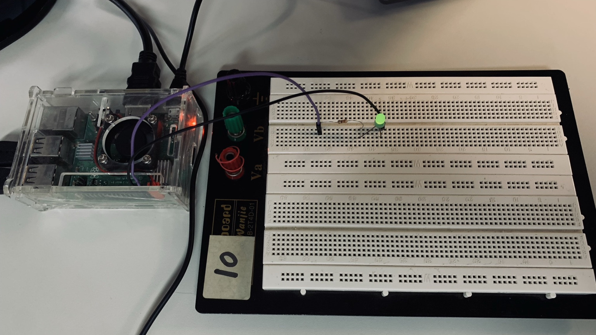
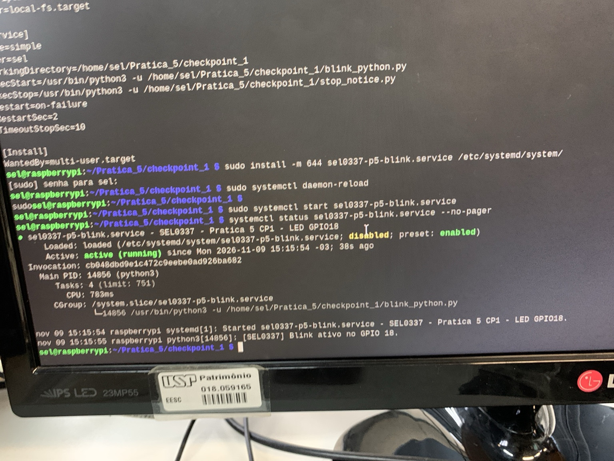
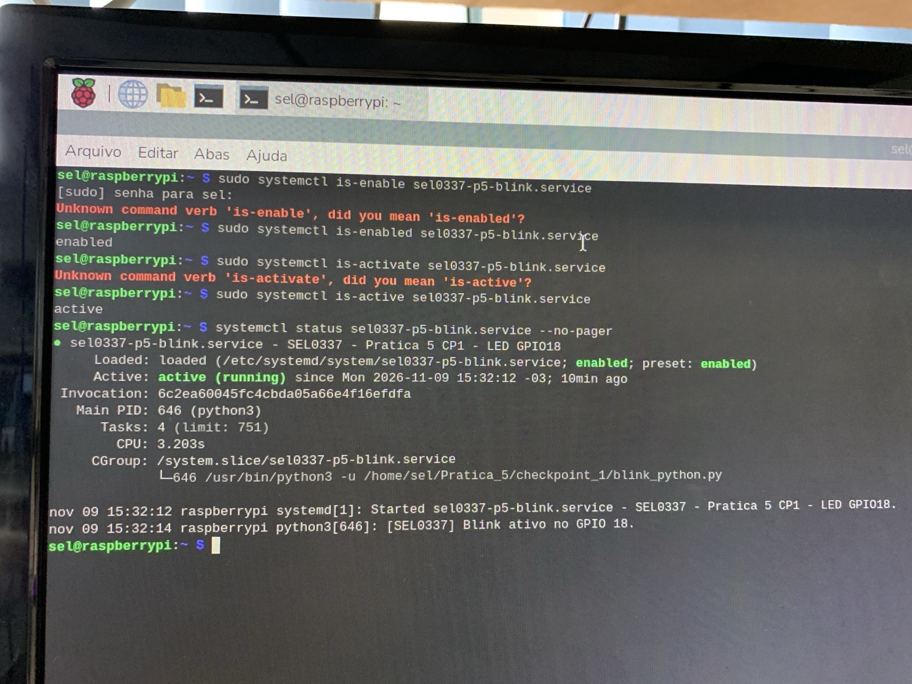
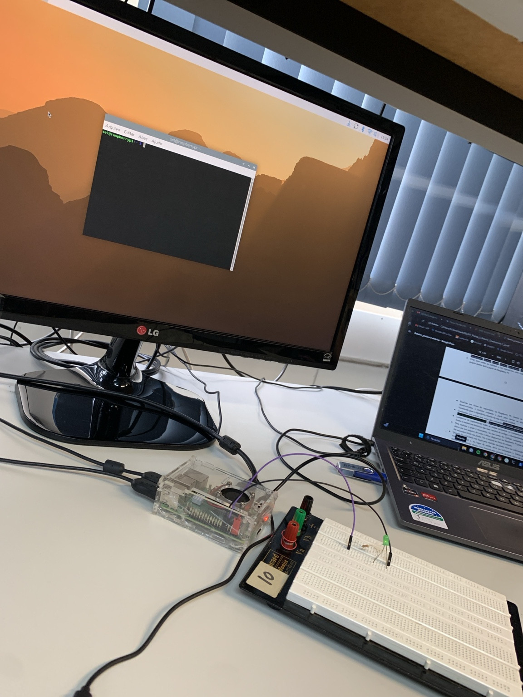

# Prática 5 — Checkpoint 1

**SEL0337 — Projetos em Sistemas Embarcados**
**Tema:** personalização de serviços de inicialização do Linux embarcado com `systemd`
**Plataforma:** Raspberry Pi · Linux · Python · GPIO Zero

| Integrante | NUSP |
|:--|--:|
| João Vitor Miranda Sousa | 14802702 |
| Fernando Shoji Ogusuku | 15636682 |
| Eduardo Yumoto Carvalheira | 15636150 |

## Resumo

Este checkpoint implementa uma aplicação de controle de LED na Raspberry Pi, gerenciada por uma unidade de serviço personalizada do **`systemd`**. Um programa Python alterna o estado de uma saída GPIO e é iniciado automaticamente durante o *boot* do sistema, **sem login do usuário nem execução manual no terminal**. A implementação inclui comando de parada (`ExecStop`), tratamento do sinal de encerramento e liberação da GPIO. A montagem foi testada em laboratório; após o reinício da Raspberry Pi, o LED voltou a piscar automaticamente. O estado do serviço foi confirmado por `systemctl` como `enabled` e `active (running)`.

## 1. Objetivo e contexto

O objetivo é demonstrar como uma aplicação de sistemas embarcados pode passar a ser gerenciada pelo sistema operacional. Em vez de iniciar um programa manualmente, configura-se uma **unidade de serviço** que especifica qual processo executar, em qual diretório e sob qual usuário, além de seu comportamento de inicialização e encerramento.

Neste projeto, o `systemd` supervisiona um programa Python que controla o LED ligado ao **GPIO18** da Raspberry Pi. O circuito simples permite observar diretamente a diferença entre executar o programa de forma manual e **integrá-lo à sequência de inicialização do Linux**.

## 2. Arquitetura da solução



### 2.1 Montagem elétrica

| Elemento | Conexão / função |
|:--|:--|
| Raspberry Pi — GPIO18 (BCM) | Pino físico 12, sinal de acionamento |
| Resistor em série | Limitação da corrente do LED |
| LED | Indicador visual do estado lógico do GPIO |
| GND da Raspberry Pi | Retorno do circuito, por exemplo pino físico 6 |

A associação **GPIO18 → resistor → LED → GND** permite acender e apagar o indicador pelo software. As conexões foram realizadas com a placa desligada. A resistência não foi medida ou registrada; por isso, nenhum valor nominal é afirmado como resultado experimental.

<p align="center">
  <a href="imagens/cp1_led_desligado.jpeg"></a>
  <a href="imagens/cp1_led_ligado.jpeg"></a>
</p>
<p align="center"><em>Figura 1 — Montagem experimental na Raspberry Pi: LED apagado (esquerda) e aceso (direita). Fotografias reais do ensaio, apenas orientadas e otimizadas.</em></p>

## 3. Implementação

### 3.1 Aplicação Python

Arquivo: [`blink_python.py`](blink_python.py).

O programa usa `gpiozero.LED(18)` e alterna o estado da saída a cada **0,2 s**, produzindo aproximadamente um ciclo completo de 0,4 s enquanto estiver ativo. O uso de `SIGTERM` e `SIGINT` permite solicitar a finalização controlada. No bloco `finally`, o programa desliga o LED e fecha o recurso GPIO.

O script foi estruturado para permanecer no primeiro plano; a supervisão e a execução como serviço são responsabilidades do `systemd`, não do próprio programa Python.

### 3.2 Unidade `systemd`

Arquivos: [`sel0337-p5-blink.service`](sel0337-p5-blink.service) e [modelo reutilizável](sel0337-p5-blink.service.template).

| Diretiva | Papel |
|:--|:--|
| `Type=simple` | Mantém o processo Python principal supervisionado pelo `systemd` |
| `User=sel` | Executa a aplicação com o usuário utilizado no laboratório |
| `WorkingDirectory` | Define a pasta que contém os arquivos do programa |
| `ExecStart` | Inicia o interpretador Python com `blink_python.py` |
| `ExecStop` | Executa `stop_notice.py` ao solicitar a parada |
| `Restart=on-failure` | Permite reinício em caso de falha do processo |
| `WantedBy=multi-user.target` | Permite habilitar a unidade no processo de inicialização |

**Funcionamento correto da parada:** `stop_notice.py` registra a execução de `ExecStop`; **não controla diretamente o LED**. O processo principal recebe o sinal de término enviado pelo `systemd` após a ação de parada e executa o bloco `finally`, desligando o LED e liberando a GPIO. Essa separação evita operações de GPIO concorrentes entre dois processos.

O arquivo `.service` incluído reproduz a configuração gerada no ambiente de laboratório, com caminhos absolutos em `/home/sel/Pratica_5/checkpoint_1`. **Ao utilizar outro diretório ou usuário, não instale esse arquivo sem adaptar os caminhos.** Utilize [`gerar_unit.sh`](gerar_unit.sh) para produzir uma unidade compatível com o local de instalação.

### 3.3 Script Bash complementar

O arquivo [`blink.sh`](blink.sh) exemplifica o controle direto pelo mecanismo legado `/sys/class/gpio`, apresentado no roteiro. A **validação experimental descrita aqui foi realizada com a aplicação Python gerenciada pelo `systemd`**; não se afirma que a versão Bash tenha sido executada na bancada. Não use ambos os programas simultaneamente sobre o GPIO18.

## 4. Validação experimental

Os testes foram realizados na Raspberry Pi do laboratório, com a montagem física do LED e o serviço Python. O procedimento incluiu iniciar o serviço, observar o LED, solicitar a parada, habilitar a inicialização automática e **reiniciar o sistema operacional**.

| Verificação | Evidência / resultado observado |
|:--|:--|
| Inicialização do serviço | `systemctl status` mostrou `active (running)` |
| Execução do programa | Log: `[SEL0337] Blink ativo no GPIO 18.` |
| Alteração do GPIO | LED fotografado aceso e apagado |
| Parada com `systemctl stop` | Funcionamento verificado durante o ensaio; arquivo `ExecStop` configurado |
| Habilitação no boot | `systemctl is-enabled` retornou `enabled` |
| Reinicialização do sistema | LED voltou a piscar sem execução manual |
| Verificação pós-reboot | `systemctl is-active` retornou `active`; status indicou `active (running)` |

<p align="center">
  <a href="imagens/cp1_status_execucao_inicial.jpeg"></a>
</p>
<p align="center"><em>Figura 2 — Serviço em execução após o acionamento inicial pelo systemctl.</em></p>

<p align="center">
  <a href="imagens/cp1_status_apos_reboot.jpeg"></a>
</p>
<p align="center"><em>Figura 3 — Verificação realizada após reinicialização: serviço habilitado, ativo e processo Python em execução.</em></p>

<p align="center">
  <a href="imagens/cp1_montagem_apos_reboot.jpeg"></a>
</p>
<p align="center"><em>Figura 4 — Visão geral do sistema montado após o boot da Raspberry Pi.</em></p>

As evidências permitem confirmar a execução do programa e a inicialização automática do serviço no equipamento utilizado. As fotografias de LED aceso/apagado representam instantes distintos de uma mesma montagem, e não constituem por si só uma medição de frequência ou temporização.

## 5. Reproduzir a aplicação

Em uma Raspberry Pi com Python 3 e a biblioteca `gpiozero`, conecte o LED com resistor em série ao GPIO18 e ao GND. A partir da pasta que contém os scripts:

```bash
# Gerar unidade com o usuario e os caminhos da Raspberry atual
bash gerar_unit.sh
cat sel0337-p5-blink.service

# Instalar e ativar o servico
sudo install -m 644 sel0337-p5-blink.service /etc/systemd/system/
sudo systemctl daemon-reload
sudo systemctl enable --now sel0337-p5-blink.service

# Inspecionar o estado e os logs
systemctl is-enabled sel0337-p5-blink.service
systemctl is-active sel0337-p5-blink.service
systemctl status sel0337-p5-blink.service --no-pager
journalctl -b -u sel0337-p5-blink.service --no-pager
```

Para testar a parada e o reinício manualmente:

```bash
sudo systemctl stop sel0337-p5-blink.service
journalctl -u sel0337-p5-blink.service -n 20 --no-pager
sudo systemctl start sel0337-p5-blink.service
```

Para reproduzir a inicialização automática, reinicie a Raspberry e verifique o LED e `systemctl status` **sem executar o script manualmente**. Em equipamentos compartilhados, combine com o responsável se o serviço deve permanecer habilitado; para desativá-lo, use `sudo systemctl disable --now sel0337-p5-blink.service`.

## 6. Ambiente e arquivos

**Ambiente registrado no laboratório:** Debian GNU/Linux 13 (Trixie), kernel `6.1.54-v8+`, Python `3.13.5`, `systemd 257`, usuário `sel` e biblioteca `gpiozero` disponível. Essas informações descrevem a placa utilizada na prática e não representam requisitos fixos de versão.

| Arquivo | Finalidade |
|:--|:--|
| [`blink_python.py`](blink_python.py) | Controle do LED e encerramento seguro |
| [`stop_notice.py`](stop_notice.py) | Ação auxiliar `ExecStop` |
| [`sel0337-p5-blink.service`](sel0337-p5-blink.service) | Configuração instalada no equipamento de laboratório |
| [`sel0337-p5-blink.service.template`](sel0337-p5-blink.service.template) | Modelo de unidade ajustável a diferentes caminhos |
| [`gerar_unit.sh`](gerar_unit.sh) | Gerador do arquivo de serviço |
| [`blink.sh`](blink.sh) | Exemplo didático Bash para GPIO sysfs legado |
| [`README_PRE_LAB.md`](README_PRE_LAB.md) | Preparação anterior ao ensaio, preservada como material auxiliar |
| [`imagens/`](imagens/) | Fotografias reais da montagem e registros dos terminais |

## 7. Conclusão

A aplicação em Python foi incorporada ao mecanismo de inicialização do Linux embarcado por meio de uma unidade `systemd`. O experimento confirmou o gerenciamento da aplicação por `systemctl` e, principalmente, a **inicialização automática do LED após o reboot**, sem intervenção do usuário. A separação entre o processo principal, a configuração do serviço e a ação `ExecStop` ilustra uma prática de gerenciamento de aplicações embarcadas que pode ser estendida a outros programas e periféricos.
