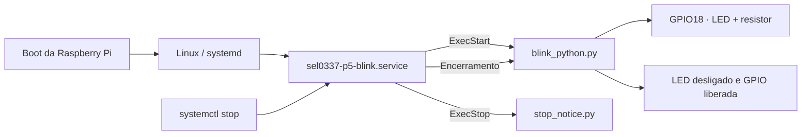
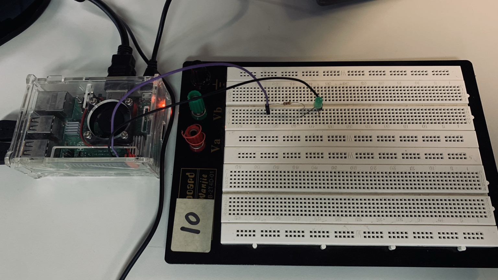
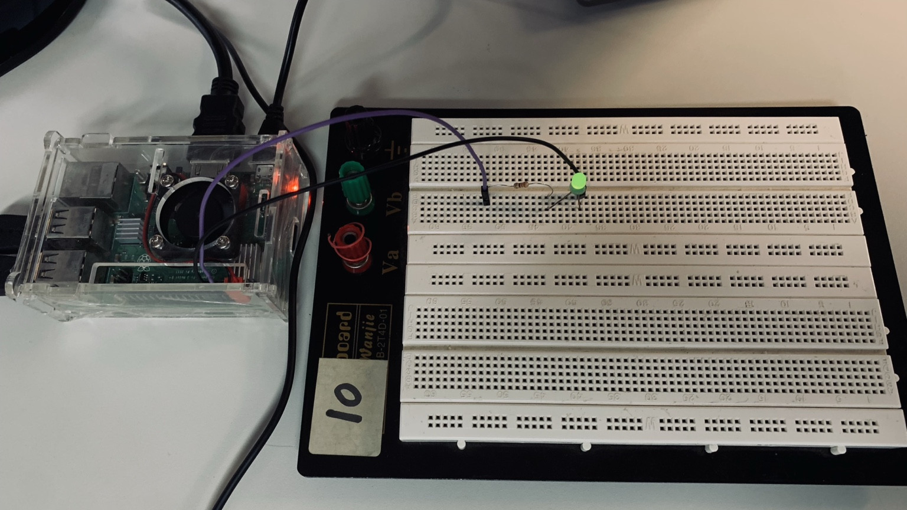
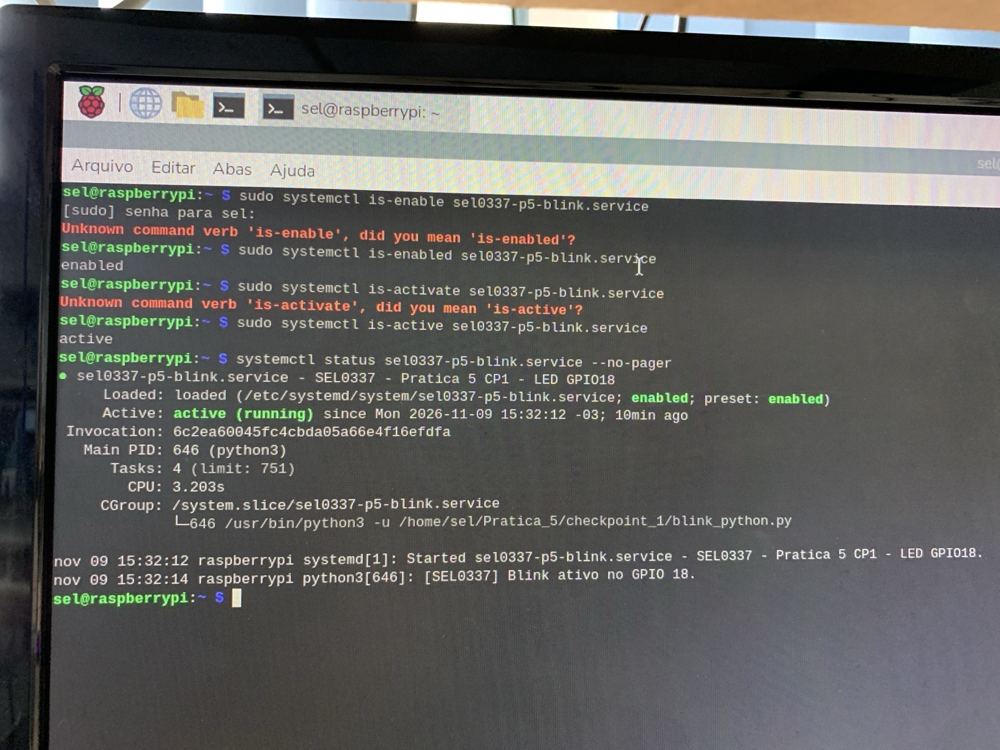
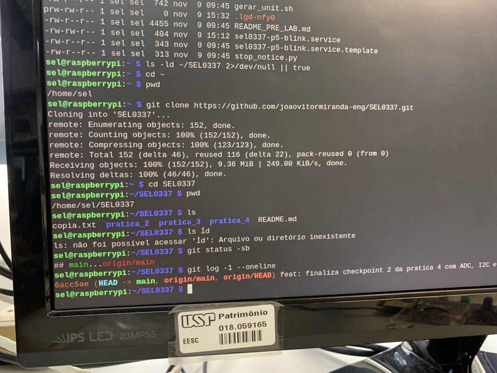
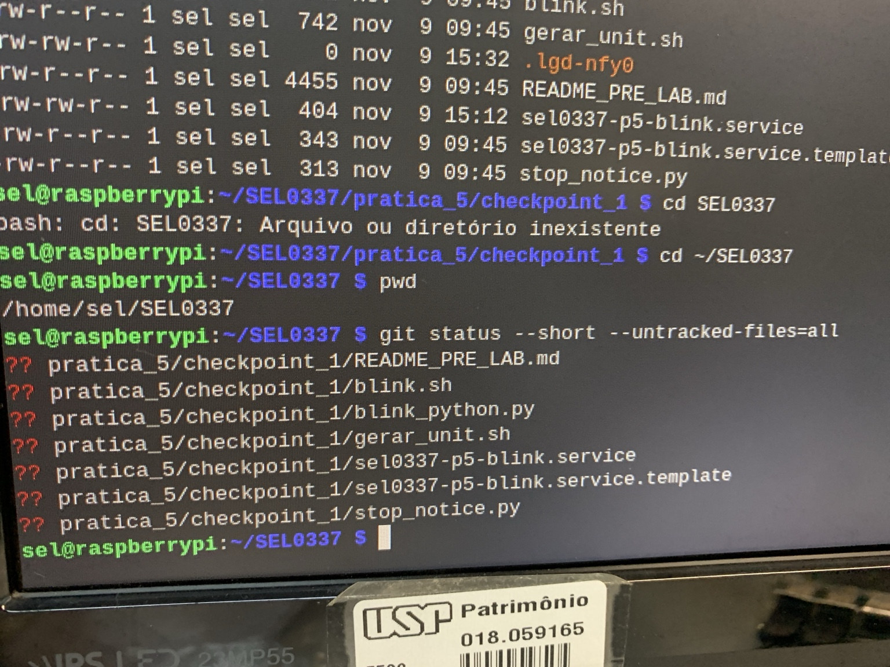

# Prática 5 — Checkpoint 2

**SEL0337 — Projetos em Sistemas Embarcados**

**Tema:** controle de versão, rastreabilidade de alterações e documentação com Git e GitHub

**Integração:** [Checkpoint 1 — aplicação Python gerenciada pelo `systemd`](../checkpoint_1/README.md)

| Integrante | NUSP |
|:--|--:|
| João Vitor Miranda Sousa | 14802702 |
| Fernando Shoji Ogusuku | 15636682 |
| Eduardo Yumoto Carvalheira | 15636150 |

## Resumo

O Checkpoint 2 consolida o **controle de versão e a documentação da Prática 5**. O projeto de referência é a aplicação do [Checkpoint 1](../checkpoint_1/README.md), que utiliza uma unidade personalizada do `systemd` para iniciar automaticamente um programa Python de acionamento de LED no GPIO18 da Raspberry Pi. Esse funcionamento foi validado em laboratório, inclusive após reinicialização do sistema operacional.

A abordagem adotada pelo grupo apresenta uma particularidade relevante: **o repositório GitHub da disciplina já vinha sendo utilizado antes da introdução formal de Git no Checkpoint 2**. Dessa forma, a atividade também reúne e contextualiza o histórico de desenvolvimento construído nas práticas anteriores, demonstrando continuidade de organização, versionamento e documentação.

## 1. Objetivos e entregáveis

- Utilizar Git e GitHub para registrar a evolução dos arquivos do projeto.
- Relacionar os códigos, a configuração `systemd` e os registros fotográficos de um experimento validado.
- Evidenciar as operações Git efetivamente observadas na Raspberry Pi durante o laboratório.
- Disponibilizar README técnico navegável e histórico de commits para consulta e auditoria.

| Entregável | Localização |
|:--|:--|
| Implementação e documentação do serviço `systemd` | [README do Checkpoint 1](../checkpoint_1/README.md) |
| Códigos e arquivos de configuração | [`checkpoint_1/`](../checkpoint_1/) |
| Documentação do versionamento e evidências Git | Este README |
| Histórico de commits | [`historico_git.txt`](../historico_git.txt) |
| Documento de submissão | [`entrega_checkpoint_2.txt`](../entrega_checkpoint_2.txt) |

## 2. Continuidade do Git/GitHub na disciplina

O uso do repositório não começou no Checkpoint 2. Há registros das atividades iniciais no [README principal da SEL0337](../../README.md), incluindo comandos associados à **Prática 1**, e uma sequência de diretórios e entregas versionadas ao longo da disciplina.

| Etapa | Registro disponível | Relação com a evolução do projeto |
|:--|:--|:--|
| Prática 1 | [README principal](../../README.md) | Registros iniciais de comandos e organização do ambiente Linux/Git |
| Prática 2 | [`pratica_2/`](../../pratica_2/) | Continuidade dos materiais da disciplina no mesmo repositório |
| Prática 3 | [`pratica_3/`](../../pratica_3/) | Organização das atividades em diretórios próprios |
| Prática 4 | [`pratica_4/`](../../pratica_4/) | Código-fonte, documentação e evidências de sistemas embarcados |
| Prática 5 — CP1 | [`checkpoint_1/`](../checkpoint_1/) | Aplicação com `systemd`, fotografias da bancada e registros de funcionamento |
| Prática 5 — CP2 | [`checkpoint_2/`](./) | Consolidação da metodologia de versionamento e documentação final |

Essa continuidade representa o principal diferencial desta entrega: o histórico Git reúne alterações reais anteriores ao estudo formal do tema nesta prática, sem reconstrução artificial de commits. A relação cronológica e os autores devem ser consultados diretamente no [histórico do repositório](../historico_git.txt).

## 3. Integração com a implementação do Checkpoint 1

O projeto embarcado documentado utiliza a seguinte arquitetura:



O programa principal utiliza a biblioteca `gpiozero`, alternando o estado do GPIO18 a cada 0,2 s. A unidade `sel0337-p5-blink.service` define a execução, a ação `ExecStop` e a habilitação para o boot. Durante os ensaios, observou-se o LED piscar e o serviço retornar **`enabled`** e **`active (running)`** após a reinicialização, sem execução manual da aplicação.

<p align="center">
  <a href="../checkpoint_1/imagens/cp1_led_desligado.jpeg"></a>
  <a href="../checkpoint_1/imagens/cp1_led_ligado.jpeg"></a>
</p>
<p align="center"><em>Figura 1 — Estados do LED na montagem experimental do Checkpoint 1.</em></p>

<p align="center">
  <a href="../checkpoint_1/imagens/cp1_status_apos_reboot.jpeg"></a>
</p>
<p align="center"><em>Figura 2 — Estado do serviço verificado na Raspberry Pi após reinicialização.</em></p>

Para detalhes de conexões, scripts, sinais de encerramento, execução e reprodução do experimento, consulte a [documentação técnica completa do CP1](../checkpoint_1/README.md), que permanece como fonte única para a implementação.

## 4. Operações Git realizadas na Raspberry Pi

Durante o laboratório, o repositório remoto da disciplina foi clonado na Raspberry Pi utilizando:

```bash
git clone https://github.com/joaovitormiranda-eng/SEL0337.git
cd SEL0337
git status -sb
git log -1 --oneline
```

A captura de tela do terminal comprova a conclusão do clone em `/home/sel/SEL0337`, a sincronização da branch `main` com `origin/main` e o commit de referência `6acc5ae` naquele instante do experimento. Posteriormente, os arquivos locais do Checkpoint 1 foram copiados para a árvore do repositório, e a listagem de novos arquivos foi inspecionada com `git status --short --untracked-files=all`.

<p align="center">
  <a href="imagens/cp2_clone_git_raspberry.jpeg"></a>
</p>
<p align="center"><em>Figura 3 — Clone e verificação do repositório executados diretamente na Raspberry Pi.</em></p>

<p align="center">
  <a href="imagens/cp2_status_arquivos_raspberry.jpeg"></a>
</p>
<p align="center"><em>Figura 4 — Arquivos da aplicação identificados pelo Git na Raspberry Pi antes de serem adicionados ao controle de versão.</em></p>

As fotografias registram **clone, inspeção de histórico e identificação de arquivos na Raspberry Pi**. Elas não são apresentadas como prova de que `git commit` ou `git push` tenham ocorrido nessa mesma máquina.

## 5. Fluxo de versionamento e rastreabilidade

A sequência abaixo resume as operações necessárias para trabalhar de forma reproduzível com o repositório. A documentação e as evidências são organizadas em diretórios próprios, sem modificar a aplicação física já validada.

```bash
# Obter ou atualizar o repositorio
git clone https://github.com/joaovitormiranda-eng/SEL0337.git
cd SEL0337
git pull --ff-only

# Inspecionar o que mudou
git status -sb
git diff --check

# Preparar e registrar uma alteracao (exemplo)
git add pratica_5/
git diff --cached --check
git commit -m "docs: documenta checkpoint 2 da pratica 5"

# Publicar e consultar o historico
git push origin main
git log
```

**Conceitos aplicados:** repositório local e remoto, área de preparação (*staging*), commit, branch `main`, sincronização com `origin/main` e rastreabilidade por hash, autor, data e mensagem.

### 5.1 Exportação do histórico

O arquivo [`historico_git.txt`](../historico_git.txt) é produzido a partir de commits verdadeiros do repositório, preservando o formato textual de `git log`:

```bash
git log > pratica_5/historico_git.txt
```

A execução deve ocorrer **na raiz do repositório**, para que sejam incluídos os commits da disciplina inteira — e não somente os arquivos desta pasta. O histórico documenta as alterações e os seus metadados; o arquivo, isoladamente, **não indica em qual computador o comando de exportação foi executado**. Para cumprir literalmente a exigência de exportação na Raspberry Pi, o comando precisa ser executado na própria placa.

## 6. Atendimento ao roteiro da entrega final

| Requisito do CP2 | Evidência / localização |
|:--|:--|
| Repositório GitHub da disciplina | [SEL0337](https://github.com/joaovitormiranda-eng/SEL0337) |
| Clone e consultas Git na Raspberry Pi | Figuras 3 e 4, registradas no laboratório |
| Programas desenvolvidos na prática | [`blink_python.py`](../checkpoint_1/blink_python.py) e [`stop_notice.py`](../checkpoint_1/stop_notice.py) |
| Arquivo de unidade personalizada | [`sel0337-p5-blink.service`](../checkpoint_1/sel0337-p5-blink.service) |
| Documentação obrigatória em README | [Checkpoint 1](../checkpoint_1/README.md) e este documento |
| Fotografia da montagem/funcionamento | Figuras 1 e 2 e demais fotos do CP1 |
| Arquivo TXT com histórico do Git | [`historico_git.txt`](../historico_git.txt) |
| Link em TXT para a submissão | [`entrega_checkpoint_2.txt`](../entrega_checkpoint_2.txt) |

O Checkpoint 3, de visão computacional, é uma atividade extra opcional e não faz parte desta documentação.

## 7. Conclusão

A Prática 5 integrou dois aspectos complementares do desenvolvimento de sistemas embarcados: **gerenciamento de uma aplicação pelo sistema operacional** e **controle de versão com documentação e rastreabilidade**. O Checkpoint 1 validou o funcionamento automático de um programa Python com `systemd` após o boot; o Checkpoint 2 registra a inserção desse projeto no repositório GitHub da disciplina e organiza seus códigos, evidências e histórico.

O resultado também evidencia a continuidade de um fluxo de trabalho que o grupo já utilizava nas primeiras práticas: registrar versões reais, preservar os arquivos-fonte, organizar cada entrega e documentar os resultados de forma verificável.
